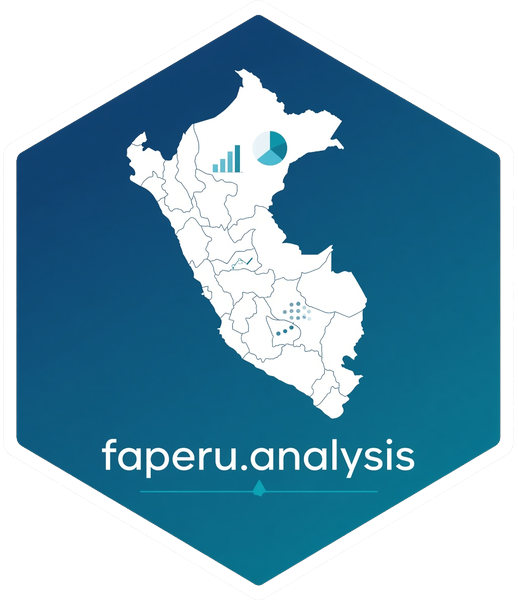

# faperu.analysis: Peruvian Official Indicators with Their Survey Design 

**Design-based estimates, INEI quality bands, checked indicators, cross-survey linkage and maps in R**

[](NEWS.md)
[](LICENSE.md)
[](https://www.r-project.org/)
[](#tests)
[](tests/testthat/)
[](#checked-indicators)
[](https://github.com/Andre031222/peru-official-surveys-r)

Companion to [faperu](https://github.com/Andre031222/peru-official-surveys-r). faperu brings the
data and builds the survey design; faperu.analysis turns them into figures with their standard
error, confidence interval, coefficient of variation and INEI quality band, ready for a table, a
map or a paper. It depends only on `faperu` and `survey`; `sf` and `ggplot2` are optional, for
maps.

Independent package, not affiliated with INEI. Microdata and boundaries belong to INEI and are
never redistributed.

---

## Overview

An official figure is more than a mean. INEI publishes each estimate with its precision and flags
the ones that are not reliable enough. faperu.analysis does the same for any indicator and any
domain (national, area, department, district or any column), and it ships seven indicators whose
2024 values match INEI's published figures to the first decimal.

## Get started

```r
remotes::install_github("Andre031222/peru-official-surveys-r")
remotes::install_github("Andre031222/peru-survey-indicators-r")

library(faperu.analysis)
p <- fpa_indicator("pobreza_monetaria", 2024, by = "department")
fpa_table(p)
fpa_map(p, title = "Monetary poverty 2024")
```

The first run downloads the ENAHO 2024 household summary and INEI's department boundaries to
faperu's cache.

## Checked indicators

Official INEI 2024 values (%) against faperu.analysis. Urban and rural in parentheses.

| Indicator | Survey | INEI 2024 | faperu.analysis |
|---|---|---|---|
| `pobreza_monetaria`, monetary poverty | ENAHO | 27.6 (24.8; 39.3) | 27.58 (24.81; 39.30) |
| `pobreza_extrema`, extreme poverty | ENAHO | 5.5 | 5.50 |
| `desempleo`, open unemployment | EPEN | 5.6 | 5.57 |
| `informalidad`, informal employment | EPEN | 70.9 | 70.95 |
| `anemia_6_35`, anaemia 6-35 months, WHO 2024 | ENDES | 35.3 (31.2; 44.7) | 35.33 (31.23; 44.65) |
| `anemia_6_35_rm363`, anaemia 6-35 months, RM 363-2022 | ENDES | 43.7 (40.2; 51.9) | 43.74 (40.17; 51.85) |
| `mujeres_productoras`, women among farm producers | ENA | 31.5 | 31.46 |

The sources are in `fpa_indicators()$source`, and the tests repeat these comparisons when the
files are on disk (`FAPERU_LOCAL`). Milk yield from the ENA is not included: INEI publishes no ENA
figure to check it against.

## Functions

| Function | What it does |
|---|---|
| `fpa_estimate(design, "var", type, by)` | Mean, proportion or total with SE, CI, CV and quality band |
| `fpa_quality(cv)` | INEI quality band from the CV |
| `fpa_indicators()` | Ready indicators and their official source |
| `fpa_indicator("desempleo", 2024, by = "area")` | Computes a ready indicator |
| `fpa_link(a = x, b = y)` | Links surveys by department or district and year |
| `fpa_geometry("district")` | INEI boundaries, cached |
| `fpa_map(x, "estimate")` | Choropleth map |
| `fpa_table(x, format = "latex")` | Table for a paper (data frame, markdown or LaTeX) |

## Precision

INEI rates each estimate by its coefficient of variation: below 5 % very good, 5 % to 10 % good,
10 % to 15 % acceptable and above 15 % for reference only. `fpa_estimate()` adds that column,
`fpa_link()` warns when it links reference-only figures and `fpa_table()` marks them with an
asterisk.

## Linking surveys

```r
p <- fpa_indicator("pobreza_monetaria", 2024, by = "department")
w <- fpa_indicator("mujeres_productoras", 2024, by = "department")
fpa_link(poverty = p, women = w)
```

Estimates from different surveys are joined by department, or by district on the 2017 Census
frame (see `faperu::fa_ubigeo()`), with a warning for districts with two parents and for
low-precision figures.

## Maps

Boundaries come from INEI's Spatial Data Infrastructure ([ide.inei.gob.pe](https://ide.inei.gob.pe/),
layers `ig_departamento` and `ig_distrito`, WFS service). They are downloaded once to
`fa_cache()/GEO` and are not part of the package. With `level = "district", base = 2017` current
districts are merged into the 2017 Census frame, the same one `fpa_link()` uses.

## Vignette

`vignette("faperu.analysis")`: poverty by department (ENAHO 2024) linked with women among farm
producers (ENA 2024), with a table and maps.

## Tests

```sh
Rscript -e 'devtools::test()'
FAPERU_LOCAL=/path/to/microdata Rscript -e 'devtools::test()'   # with the official figures
FPA_ONLINE=1 Rscript -e 'devtools::test()'                       # and INEI's geoserver
```

---

## En español

faperu.analysis convierte los datos de faperu en cifras oficiales: media, proporción o total con
error estándar, intervalo de confianza, coeficiente de variación y la banda de calidad del INEI
(muy buena, buena, aceptable o referencial). Trae siete indicadores cuyas cifras de 2024 coinciden
con las publicadas por el INEI: pobreza y pobreza extrema (ENAHO), desempleo e informalidad
(EPEN), anemia infantil con los dos criterios (ENDES) y mujeres productoras (ENA). También une
encuestas por departamento o distrito y año, y hace tablas y mapas con los límites del INEI.

```r
library(faperu.analysis)
p <- fpa_indicator("pobreza_monetaria", 2024, by = "department")
fpa_table(p)
fpa_map(p, title = "Pobreza monetaria 2024")
```

## License and authors

Code under the MIT license, see [LICENSE.md](LICENSE.md).

Richar Andre Vilca Solorzano ([ORCID 0009-0003-2385-5263](https://orcid.org/0009-0003-2385-5263))
and Fred Torres Cruz ([ORCID 0000-0003-0834-6834](https://orcid.org/0000-0003-0834-6834)).
